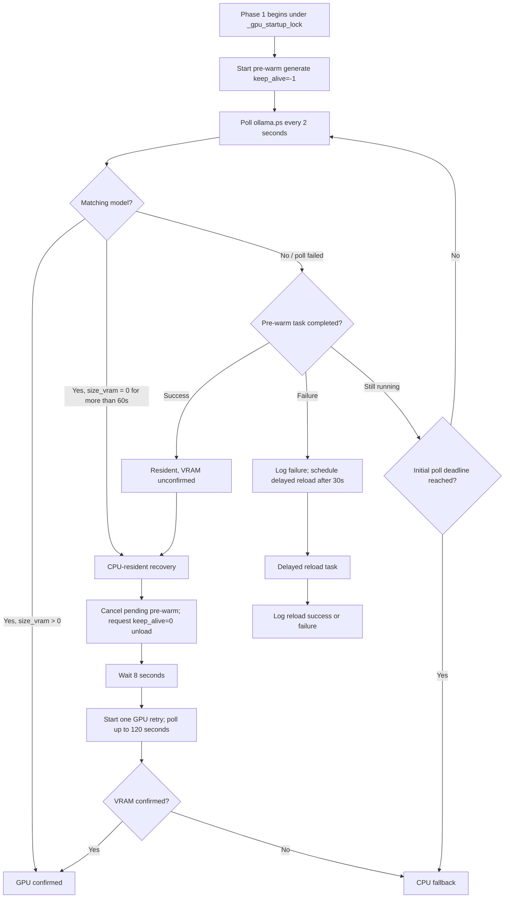

# GPU Bootstrap Recovery: Phase 1 Review

**Scope:** evidence-based review and test proposal for the Phase 1 chat-model bootstrap in
`Kaiacord.py`. This is a design/review document only. `Kaiacord.py` is explicitly listed in
`CONTRIBUTING.md` under “Do NOT Touch”; no runtime code was changed for this issue.

**Reviewed implementation:** `on_ready() → _do_phase1()`, including the pre-warm task,
`ollama.ps()` residency polling, CPU-resident unload/retry, and delayed pre-warm recovery callback.

## Current state machine

The implementation uses two related signals:

- **Resident:** Ollama's process list contains a model name matching `config.chat_model`.
- **VRAM-confirmed:** the matching entry reports `size_vram > 0`.

A successful generate call is also treated as evidence of residency when the process-list poll
has not found a matching model, but it does not establish that the model is in VRAM.

The initial residency poll runs for `config.model_load_timeout + 120 seconds`; each process-list
request is wrapped in a 10-second `asyncio.wait_for`. The CPU-resident recovery path waits
8 seconds after requesting unload, then retries for up to 120 seconds.

## Observed behavior and review findings

| Area | Current behavior | Assessment |
|---|---|---|
| GPU success | A matching model with positive `size_vram` ends Phase 1 successfully. | Clear positive signal, but the code does not record the observed VRAM amount or matched model name as structured state. |
| CPU-resident detection | A matching model with zero VRAM is treated as CPU-resident only after 60 seconds. | Reasonable delay, but zero VRAM can also mean an incomplete or inconsistent `ps()` response; retain an explicit “unknown” state. |
| Unload | Pending pre-warm is cancelled and awaited; `generate(keep_alive=0)` is attempted with a 15-second timeout. | Cancellation and unload exceptions are swallowed. Logs do not distinguish unload success, timeout, cancellation, and failure. |
| Retry | A second pre-warm is started and checked for up to 120 seconds. | The retry task is registered, but its exception/result is not explicitly reconciled after the poll deadline. |
| Initial timeout | If no residency signal arrives by the initial deadline, Phase 1 returns false. | A still-running initial pre-warm task is not explicitly cancelled/awaited on this path; it may continue after CPU fallback is reported. |
| Failed pre-warm callback | A failed pre-warm schedules another generate after 30 seconds. | The delayed reload is not registered with `task_registry` and does not reacquire `_gpu_startup_lock`; it can outlive the startup phase and race other Ollama work or shutdown. |
| Poll errors | `ollama.ps()` failures are logged at debug level and polling continues. | The final status does not distinguish daemon unavailable, residency unknown, genuine CPU residency, and unload failure. |
| Thread timeout | `ollama.ps()` runs inside `asyncio.to_thread` and is wrapped in `wait_for`. | Cancelling the await does not stop an already-running worker thread. A permanently blocked call could leave a worker behind while later polls submit more work. |
| Reconnect | `_ready_done` is set before Phase 1; subsequent gateway `on_ready` calls skip reinitialization. | Intentional reconnect behavior, but it means a failed boot is not automatically retried by a gateway reconnect. |

### Answers to the review questions

1. **Are transitions observable?** Partially. There are human-readable action/success/error messages, but no single state field or structured transition event. In particular, the unload sub-sequence can fail silently.
2. **Can pre-warm race recovery?** Yes, in two places worth guarding in a future refactor: the delayed 30-second reload runs outside the startup lock, and the initial timeout path does not explicitly retire a still-running task before returning CPU fallback.
3. **What if unload or `ollama.ps()` fails?** Unload exceptions are suppressed and the retry proceeds without proof that the old runner was released. Poll exceptions are retried until a deadline; the final state loses the reason residency was not confirmed.
4. **Is CPU fallback accurately described?** Not always. The final message says the model failed to load into VRAM, but it does not say whether the model is absent, resident in system RAM, or simply unobservable because Ollama's process-list call failed.
5. **Can this be tested without hardware?** Yes, after extracting a narrow bootstrap coordinator behind an approved interface. A fake Ollama client can control generate completion, process-list responses, cancellation, delays, and exceptions.
6. **Can orchestration stay in `Kaiacord.py`?** Yes. A future approved design can keep `on_ready()` as orchestration and move the state transitions, deadlines, and observation model into a small GPU infrastructure module. No such refactor is authorized by this review.

## Recommended state and telemetry model

A future implementation should report one terminal state, without conflating residency with GPU placement:

- `gpu_confirmed`: model match and positive VRAM allocation observed.
- `cpu_resident`: model match observed, but VRAM allocation remained zero after the recovery policy.
- `not_resident`: pre-warm completed/failed and no matching runner was observed.
- `residency_unknown`: Ollama could not be queried reliably before the deadline.
- `unload_failed`: CPU-resident runner could not be confirmed unloaded before retry.
- `cancelled`: shutdown or explicit cancellation retired the bootstrap.

Each transition should log the model identifier, prior and next state, elapsed time, attempt number, and a bounded error category. Record matched `size_vram` when available. Never log tokens, prompt contents, or credentials.

The coordinator should own every task it creates: register delayed recovery tasks, serialize them against other GPU startup/recovery work, stop scheduling after shutdown begins, and cancel/await outstanding pre-warm work when its deadline expires. An `asyncio.wait_for(asyncio.to_thread(...))` timeout should be treated as a timed-out observation, not proof the worker thread stopped.

## Hardware-free test plan

Use a fake Ollama client and a controllable clock/sleeper. No Discord client, real Ollama daemon, model download, or GPU is needed.

| Test | Fake behavior | Expected result |
|---|---|---|
| Direct GPU success | `generate` succeeds; `ps` reports the configured model with positive VRAM. | `gpu_confirmed`; no unload or retry. |
| Delayed GPU success | Initial `ps` calls are empty; a later call reports positive VRAM. | Poll stays bounded and ends `gpu_confirmed`. |
| CPU residency | `ps` reports the model with zero VRAM beyond the threshold. | One unload attempt, one stabilization wait, at most one retry. |
| Unload failure | `keep_alive=0` raises or times out. | Explicit `unload_failed`; do not report clean CPU fallback or claim the old runner was released. |
| Pre-warm failure | Initial `generate` raises. | Failure is recorded; a single supervised recovery task follows the serialization and shutdown policy. |
| Initial deadline | `ps` remains empty and pre-warm remains pending. | Pending task is cancelled/awaited; terminal state is explicit; no orphan task remains. |
| Retry failure | Retry never confirms VRAM or raises. | Bounded terminal state; retry task exception is consumed and logged. |
| Poll timeout | Fake `ps` stalls beyond its deadline. | State becomes unknown if the deadline expires; late worker completion cannot mutate terminal state. |
| Malformed process list | `ps` returns empty, malformed, dict, and object-shaped responses. | Defensive parsing; no false positive model match. |
| Shutdown during recovery | Shutdown begins during initial wait, unload, or delayed recovery. | All owned tasks stop; no delayed Ollama request is issued after shutdown. |
| Gateway reconnect | `on_ready` fires a second time after an initial failure. | Existing one-shot policy is explicit and telemetry shows that no automatic retry occurred. |

The fake should also verify exact call counts, all timeout bounds, task registry membership/removal, and
that no test invokes the global GPU teardown or mutates production memory. The suite should be marked
offline and must not require the `ollama`, `gpu`, `slow`, or `network` markers.

## Decision

The current implementation is deliberately left untouched because `Kaiacord.py` is a protected
path. The review identifies concrete observability and task-lifecycle gaps and supplies a test plan
for a future, separately approved extraction. This document satisfies the evidence/review stage; it
does not claim that live GPU acceptance has been performed.
