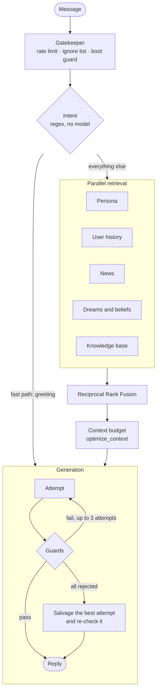

# How Kaia works

A message's path through the bot, what she keeps between conversations, and when she speaks first.
Module-level detail is in [overview.md](overview.md) and [utils-reference.md](utils-reference.md).

## A message, start to finish

1. **Intent** is decided by regex matchers on the CPU, so the model is never woken just to
   label a message.
2. **Retrieval** runs BM25 and dense vectors (`nomic-embed-text-cpu`) in parallel over books
   and articles, the Project 1999 wiki and guides, news briefs, her dream reflections and notes,
   and conversation history — the asker's, and that of anyone the message names. Every chunk
   reaches the prompt labelled as what it is: something said to her, something she thought,
   or something she read. The persona is not retrieved; it goes into every prompt whole.
3. **Context** is budgeted once, by `optimize_context`: a system reserve and the reply are set
   aside, and what remains is split between retrieval and conversation history.
   A turn is also read for how much it asks of her: a passing remark or a quick question carries a
   note beside the message to answer at that size, and a turn that offers room carries none. Her
   beliefs reach the prompt only when the speaker's own words are about them.
4. **Generation** uses two temperatures: 0.70 for conversation and 0.35 for answers grounded in
   documents. A reply the guards reject is regenerated; if every attempt is rejected, the best one
   is repaired and must pass the full pipeline on its own before it is used.

## What persists between conversations

- **Mood.** A valence, arousal and energy vector with a six-hour half-life. It shapes her
  vocabulary, how often she reacts, and the status line under her name.
- **Relationships.** Per-person event logs across five familiarity stages, from stranger to
  inner circle.
- **Beliefs.** A store of up to 100 positions with confidence, formed and revised overnight.
- **Memory anchors.** Up to 100 weighted episodic memories. The ones she keeps recalling are kept
  as they age, and one that has faded comes back as a fragment ("something about a boat — I've
  lost the rest") rather than a reconstruction.
- **Notes.** When she says she's adding something to her notes, she writes one — what was shared
  and what she made of it — into `knowledge_base/kaia_notes/`, where retrieval finds it again.
- **Open threads.** Ideas she has wondered about on more than one day come back in her passing
  thoughts, and colour her interest when a conversation touches them.
- **Dreams.** Between 03:00 and 05:00 she reads over the day, writes reflections, extracts
  beliefs and updates a rolling identity journal.

### Direct messages stay private

A DM (or an invitation-only thread) is answered, but it is kept apart from everything she learns
in public. It is logged to `memory/dm_logs/`, never to `knowledge_base/user_logs/`, which retrieval
serves to every public reply. It does not update relationships, mood, beliefs or her proactive
state, its text never reaches the diagnostic logs (the security replay file, the hallucination log,
the consistency watchdog's prompts), and the memory phrases ("kaia remember …", "kaia who do you
know") and `!snapshot` do nothing there. Anything she reads aloud from outside, such as a forwarded
message or a scraped page, has the pipeline's own markers neutralised before it reaches the prompt.

## Speaking first

Kaia sometimes speaks without being asked: an opener when she has something on her mind, an
idle remark when a channel has gone quiet, an observation about a conversation she followed, a
passing thought, and a morning write-up of what her night shift saw. All of these go through one
gate, configured in a single `unprompted:` block: one daily limit, a minimum gap per kind of post
(so a quip never uses up a passing thought's turn), a short spacing between any two posts, and
one set of posting hours. A post held only by that spacing waits in a queue and goes out in turn
rather than being dropped. Each post carries a short label that fits it (*Unspooling* when she revisits
an earlier view, *Down the rabbit hole* for something she read), and you choose which kinds also
go to her Bluesky feed. A dream or a passing thought about someone can become how she opens a
conversation with them — once a day at most, and only while they're around.

### Broadcast deduplication and observation quotes

Proactive openers, observation digests, and monologue broadcasts share a delivery-time
duplicate guard. The duplicate check, Discord send, and successful-history write are serialized;
queued posts are checked when they reach the send queue, and a failed send is not recorded.
The history keeps at most 50 entries and compares within a one-hour window. Opener signatures
use the first 16 lowercase lexical words, so punctuation-only differences share a signature.
Exact signatures match; longer signatures can also match at a similarity ratio of 0.88 or higher.
New entries are channel-scoped. Legacy entries without a channel ID are compared conservatively
across channels.

Observation digests may quote only wording found within one speaker's turn. Straight and curly
single/double quotes are checked; an unmatched opening delimiter is invalid even when its
trailing words happen to appear in the conversation. A rejected draft gets one quote-free
corrective retry, and the replacement is checked again. A still-invalid or unusable replacement
is neither stored nor broadcast.

A consistency check flags a reply that concedes one of her strongest beliefs just because someone
pushed back, and strips the capitulation before it is sent. Asked about space weather, launches or
the ISS, she answers from the live feeds; asked for a favourite, from the books and music she has
actually spent time with.
